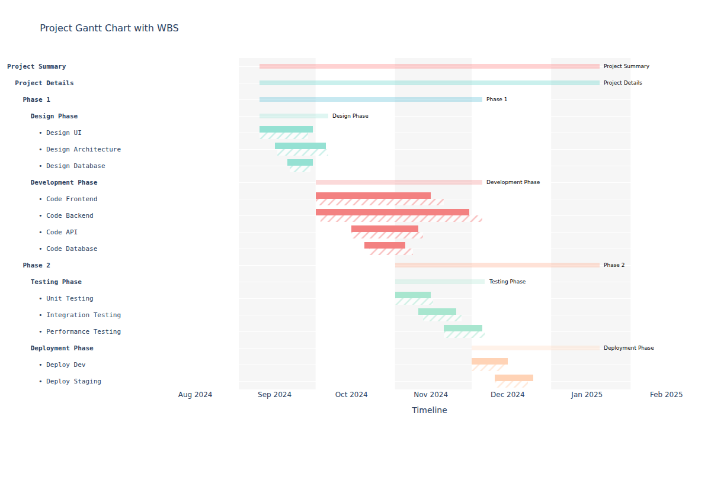

# Ganttify Python

[](https://github.com/AhmedAredah/ganttify-python/actions/workflows/ci.yml)

Interactive Gantt charts with a Work Breakdown Structure, planned and actual
schedules, and self-contained HTML export. This is the Python adaptation of
[Ahmed Aredah's Ganttify R package](https://github.com/AhmedAredah/Ganttify).



The repository and distribution are named `ganttify-python`; the Python import is
`ganttify`. This keeps the original name recognizable while making the language
clear. The package version starts independently at `0.1.0`.

## Install

Install from the repository:

```sh
python -m pip install "git+https://github.com/AhmedAredah/ganttify-python.git"
```

Or clone and install locally:

```sh
git clone https://github.com/AhmedAredah/ganttify-python.git
cd ganttify-python
python -m pip install .
```

A PyPI release is not required for either command. Optional pandas support is
available with `python -m pip install ".[dataframe]"` from a local checkout.
Plotly is the only direct runtime dependency; records work without pandas.

## Quick start

```python
from datetime import date

from ganttify import ganttify
from ganttify.datasets import get_test_project

project = get_test_project()
chart = ganttify(
    project["wbs_structure"],
    project["activities"],
    color_config={"mode": "wbs", "wbs": project["colors"]},
    as_of=date(2025, 1, 1),
)
chart.write_html("project.html")
# chart.show(renderer="browser") opens the interactive chart in your browser.
```

The sample contains an unfinished activity. Setting `as_of` makes its displayed
actual end reproducible. Omit it to use the current date.

In a notebook, display `chart` as the final expression in a cell. Use the wrapper's
`show()`, `to_html()`, or `write_html()` to retain the custom browser interactions.
`chart.figure` exposes a normal Plotly figure for further customization; exporting
that bare figure directly does not install Ganttify's browser runtime.

## Features

- Multiple WBS roots, arbitrary hierarchy depth, inherited activity colors, and
  independent WBS/activity visibility.
- Planned and actual bars, patterned actual schedules, in-progress work, inclusive
  durations, and optional dimming of past planned activities.
- WBS, uniform, or attribute-based colors; label templates and custom tooltip fields.
- Milestone lines and date-range areas with stacked or hidden labels and tooltips.
- Pan, zoom, vertical row scrolling, adaptive timeline labels and backgrounds,
  and minimum-width short bars that preserve the original dates in tooltips.
- Left-aligned hierarchy labels with truncation and accessible full text on hover.
- Date axis at the bottom, top, or both edges; offline HTML with Plotly embedded.

## Your own data

Use a list of dictionaries, a column-oriented mapping, or a pandas DataFrame:

```python
from ganttify import ganttify

wbs = [
    {"ID": "P", "Name": "Project", "Parent": None},
    {"ID": "D", "Name": "Design", "Parent": "P"},
]
activities = [
    {
        "WBS_ID": "D",
        "Activity_ID": "A1",
        "Activity_Name": "Develop design",
        "Start_Date": "2026-11-01",
        "End_Date": "2026-11-20",
        "Status": "Planned",
    },
]
chart = ganttify(
    wbs,
    activities,
    tooltip_config={"activity": {"Status": "Delivery status"}},
)
chart.write_html("design.html")
```

Dates accept `datetime.date`, `datetime.datetime`, ISO `YYYY-MM-DD`, and the default
`MM/DD/YYYY`. Supply `date_format` for another explicit `strptime` format.
IDs must be nonempty and unique within their respective WBS/activity collections.
Invalid parents, cycles, unknown WBS references, and reversed dates produce clear
errors. Inputs are copied rather than modified.

## Configuration

All six configuration groups accept nested dictionaries or typed configuration
objects. Partial dictionaries merge with defaults; unknown keys are rejected.

```python
from ganttify import LayoutConfig

chart = ganttify(
    wbs,
    activities,
    color_config={
        "mode": "attribute",
        "attribute": {"column": "Status", "mapping": {"Planned": "#3498DB"}},
    },
    display_config={"activity": {"show_names_on_bars": True}},
    label_config={"activity": {"yaxis": "{id}: {name}"}},
    bar_config={"activity": {"height": 0.7, "opacity": 0.9}},
    layout_config=LayoutConfig(max_visible_rows=12, xaxis_position="both"),
    milestone_lines=[
        {"date": "2026-11-20", "label": "Design review", "color": "#9B59B6"},
    ],
)
```

See [API reference](docs/api.md), [architecture](docs/architecture.md), and
[porting notes](docs/porting.md). Runnable examples are in
[examples/basic.py](examples/basic.py) and [examples/advanced.py](examples/advanced.py).

## Python and platform policy

The compatibility target is CPython 3.11–3.15. The CI matrix covers each of those
versions on Linux and Python 3.13 on Windows and macOS. A configured job is a test
target; its result in [Actions](https://github.com/AhmedAredah/ganttify-python/actions)
is the evidence of verification. Other interpreters and future Python versions
are not yet part of the tested compatibility policy.

The minimum follows the currently maintained Python versions listed by the
[Python Developer's Guide](https://devguide.python.org/versions/). Runtime dependency
constraints are `plotly>=6,<8`; CI also exercises Plotly `6.0.0`. Package metadata uses
[`pyproject.toml`](https://packaging.python.org/en/latest/guides/writing-pyproject-toml/)
and a `src` layout. Browser interaction requires JavaScript. Node.js is needed only
for development tests.

## Development

```sh
python -m pip install -e ".[dev,dataframe]"
python -m ruff check .
python -m ruff format --check .
python -m mypy src
python -m pytest --cov=ganttify
node --test tests/test_runtime.mjs
python -m build
python -m twine check dist/*
```

CI additionally installs the built wheel outside the checkout and checks its HTML
export and bundled JavaScript. See [contributing](CONTRIBUTING.md).

## License and sources

Copyright (C) 2026 Ahmed Aredah. Distributed under GPL-3.0-only; see
[LICENSE](LICENSE) and [NOTICE](NOTICE). The upstream adaptation baseline is
[Ganttify 0.2.12, commit 5853bf7](https://github.com/AhmedAredah/Ganttify/tree/5853bf763e1ad3fc25d82e4a9e9435d3ee798bd1).

Plotly provides the underlying chart model and HTML serialization. Its official
[HTML export reference](https://plotly.com/python-api-reference/generated/plotly.io.to_html.html)
describes offline embedding and the `post_script` hook used by the wrapper.
